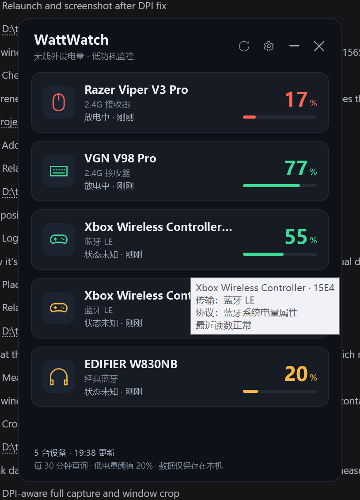
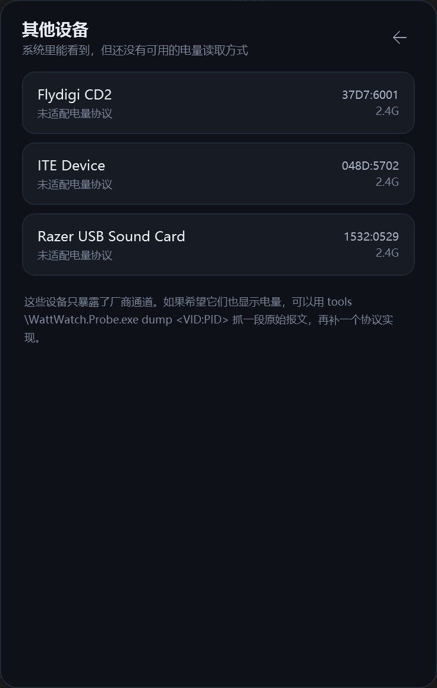

# WattWatch · Wireless Battery Monitor for Windows


[](https://github.com/xiebro01/WattWatch/releases)

[简体中文](README.md) | English

A small Windows tray app that shows battery levels for 2.4 GHz receivers and Bluetooth
peripherals in one place — and, unlike most of the tools out there, **polls once every
30 minutes by default**, opens and closes its HID handle for every single reading, and
backs off exponentially when a device stops answering. The point is to see the battery
without draining the battery.

> This is a clean-room alternative to [evren-oct/vigil-watt](https://github.com/evren-oct/vigil-watt),
> written after using it: it did not recognise the Viper V3 Pro (`1532:00C1`) or the
> Flydigi Apex 5, and its polling cadence was too aggressive for 2.4 GHz gear.
> WattWatch uses a "passive first, low-frequency active" schedule and ships the
> verified protocols as standalone probe tools.

## Screenshots





## Supported devices

| Device | How it is read | Status |
| --- | --- | --- |
| Razer Viper V3 Pro | `1532:00C1`, 90-byte vendor feature report (class 0x07 / 0x80) | Verified on hardware: 17%, matches Synapse |
| VGN V98 Pro | `320F:5088`, 0xFF1C collection, `0x1A` query on report id 0x04 | Verified on hardware: 77% |
| Edifier W830NB | `DEVPKEY_Device_BatteryLevel` on the classic-Bluetooth HFP gateway node | Verified on hardware: 20% |
| Huawei FreeBuds Studio | Same classic-Bluetooth HFP node property | Pending verification (listed under "Other devices" if Windows has no cached level) |
| Flydigi Apex 5 | `37D7:2501`, `5A A5 01` GET_INFO | Verified on hardware: 100% |
| Sony DualSense / Edge | `054C:0CE6` / `0DF2`; read feature report 0x09, then parse the 0x31 state report | Verified on hardware: 55% |
| Any other Bluetooth device | Battery level Windows already caches (including BLE, e.g. Xbox pads) | Detected automatically |

### Disconnect policy

- A 2.4 GHz receiver stays plugged in whether the peripheral is on or off, so the device
  tree cannot tell "switched off" from "still there". Two consecutive failed reads
  (about one interval, ~1 hour by default) are treated as disconnected: the card leaves
  the main list and moves to **Other devices** with "已断开 · last reading x ago".
- Hidden devices keep being polled at the normal cadence, so they come back to the list
  by themselves as soon as they answer again — no restart needed.
- Bluetooth devices are removed immediately: Windows drops their nodes on disconnect.

### Other devices

The bottom of the window has an **Other devices (N)** entry. Devices that expose a vendor
collection but have no battery reader yet (for example the Razer USB sound card
`1532:0529`, Flydigi CD2 `37D7:6001`, the motherboard ITE `048D:5702`) are listed there
with "no battery protocol", so you can tell "not plugged in" from "plugged in, unsupported".

## Why it is power-friendly

| Design choice | Effect |
| --- | --- |
| 30-minute default interval, adjustable 5–60 min | An order of magnitude fewer radio wake-ups than a 10–15 s poller |
| Reopen → close the HID handle for every reading | The receiver never keeps a device awake because a read is parked on its input channel |
| Bluetooth levels read from the cached Windows device property | No GATT connection, no AT command — **zero cost for the headset** |
| Exponential backoff on silence (up to 4 h) | A sleeping mouse is not poked over and over |
| A 15 s device-tree rescan (metadata only, no device I/O) | Fast plug/unplug detection without any wireless traffic |
| No BLE scanning, no input-report subscription | Near-zero CPU and Bluetooth activity while idle |

## Usage

1. Run `WattWatch.exe` (or `WattWatch.exe --tray` to start hidden).
2. The tray icon shows the lowest battery level. Left click opens the window, right
   click gives the menu (open / refresh now / settings / start with Windows / quit).
3. Settings: poll interval, low-battery threshold, autostart, close-to-tray.
4. The small grip in the bottom-right corner resizes the window.
5. History lives in `%LOCALAPPDATA%\WattWatch\history\*.jsonl`, settings next to it in
   `settings.json`. After 12 hours of discharge data a card also shows an estimate of
   remaining runtime.

## Build

Requires the .NET 8 SDK (the script looks in `.dotnet\`, then `D:\tools\dotnet`, then PATH).

```powershell
# Debug build
dotnet build WattWatch.sln -c Debug

# Self-contained single file (~63 MB)
powershell -ExecutionPolicy Bypass -File scripts\publish.ps1

# Framework-dependent build (~2 MB, needs the .NET 8 Desktop Runtime)
powershell -ExecutionPolicy Bypass -File scripts\publish.ps1 -FrameworkDependent
```

## Layout

```
src/WattWatch.Core/      HID enumeration and handles, protocol probes, Bluetooth, scheduler, history
src/WattWatch.App/       WPF tray UI
tools/WattWatch.Probe/   Console harness (list / read / dump)
```

## Command-line probe

```powershell
WattWatch.Probe.exe list               # every HID collection and Bluetooth battery node
WattWatch.Probe.exe read               # one reading per device, with the raw evidence
WattWatch.Probe.exe dump 37D7:2501 5   # passively capture 5 s of input reports (for new devices)
```

## Known limitations

- The Razer and Flydigi protocols require sending one query frame, so this is **not a
  zero-write tool**; the design goal is to keep the frequency minimal and back off.
- The Flydigi Apex 5 frame layout comes from SDL's `SDL_hidapi_flydigi.c` and has been
  verified on hardware here. If a reading looks wrong, capture with
  `WattWatch.Probe.exe dump 37D7:2501` and adjust `FlydigiProtocol`.
- Bluetooth headset levels depend on the headset reporting over HFP; some only report
  once, at connection time.
- Devices with identical names get a MAC suffix (e.g. two Xbox pads).

## Changelog

See [CHANGELOG.md](CHANGELOG.md).

## Credits

Protocol details were derived from [OpenRazer](https://github.com/openrazer/openrazer)
(Razer 90-byte frames), [SDL](https://github.com/libsdl-org/SDL) (Flydigi V2 frames,
DualSense reports) and VigilWatt's hardware notes (VGN / Razer / Bluetooth node ideas).
The implementation here is original.

## License

MIT — see [LICENSE](LICENSE).
